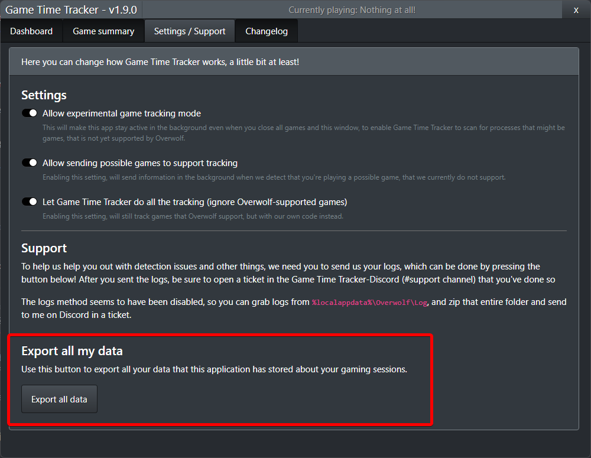

---
layout: post
title: "Game Time Tracker - The End"
date: 2022-01-07 09:43:20 +0000
author: NoLifeKing
tags:
- game time tracker
---

After having this project up for a while, I've realized that manually managing supported games, based on what people play, is painstakingly bothersome, when there's so much to keep track of.

So, it is time for me to say goodbye to Game Time Tracker.
<!--more-->
The repository for the app is open source, if anyone wants to try to make something on their own. 

I'll keep the database running until march 2022, but after that I'll decommission the domain and engine with the database. 

It was a fun project in the start, but it started to get hard to maintain as time went on. I'm sorry for not updating anything in a while, I hope you find a better application to keep track of your played games. 

I've made a final update, that will give you the ability to export the database with all stored sessions that the application has.
<figure class="kg-card kg-image-card kg-card-hascaption"><figcaption>New export option for last version of Game Time Tracker</figcaption></figure>
Database can be found at: <a href="https://gamedb.itssimple.se/games" rel="noreferrer noopener">https://gamedb.itssimple.se/games</a>, for all games that I've manually added. And some games will have another type of ID, to be matched with the Overwolf GameList.xml (where some games will be marked as SpiderMan, because of.. "game.exe"

There's also the currently not mapped executables at <a href="https://gamedb.itssimple.se/suggested-games" rel="noreferrer noopener">https://gamedb.itssimple.se/suggested-games</a>

Ignored data is stored in 3 arrays: <a href="https://gamedb.itssimple.se/ignored-data" rel="noreferrer noopener">https://gamedb.itssimple.se/ignored-data</a>

And I mark apps/executables as interesting based on paths and window classes: <a href="https://gamedb.itssimple.se/interesting-info" rel="noreferrer noopener">https://gamedb.itssimple.se/interesting-info</a>

The repository can be found at <a href="https://github.com/itssimple/overwolf-game-time-tracker">https://github.com/itssimple/overwolf-game-time-tracker</a>

Thank you, all users, for this time.
