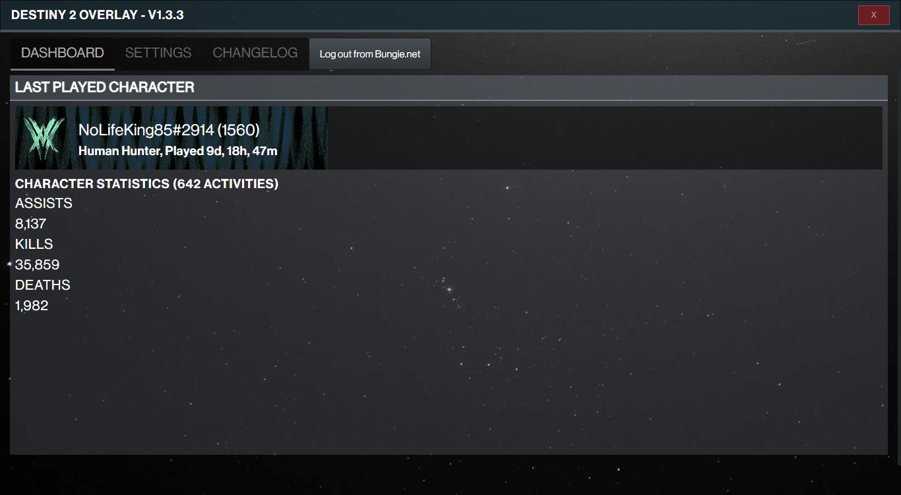
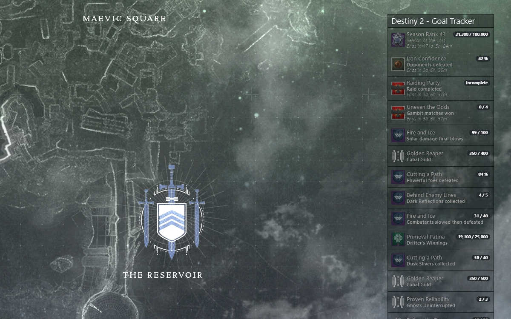

---
layout: post
title: "Destiny 2 - Goal Tracker released"
date: 2022-04-25 16:35:22 +0000
author: NoLifeKing
tags:
- destiny 2
- overlay
- overwolf
---

I totally forgot to write some news about this when it was released, but any time is better than never, right?

Anyway, for some time, I've been developing yet another Overwolf app, because I found something that I wanted to have for myself, a bit like the Game Time Tracker, but a bit easier to manage. :)
<!--more-->
You can find the <a href="https://www.overwolf.com/app/NoLifeKing85-Destiny_2_-_Goal_tracker">Destiny 2 Goal Tracker</a> on the Overwolf App Store.
<figure class="kg-card kg-image-card kg-card-hascaption"><figcaption>It looks something like this (but with your data, after you've authenticated)</figcaption></figure><figure class="kg-card kg-image-card kg-card-hascaption"><figcaption>Here's an old image from the early development versions of the overlay, showcasing the season rank and other things that the overlay allows you to track.</figcaption></figure>
And, while I have some plans for what to do with the main window, like adding more stats, graphs and other things, if there's anything you wonder, you're welcome to join the <a href="https://discord.com/invite/ZAMNfRpRDb">Discord</a> for this app!
