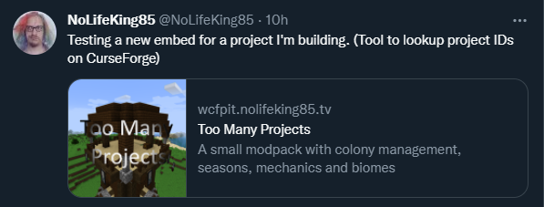

---
layout: post
title: "What CurseForge Project is This? (again)"
date: 2022-05-10 05:58:34 +0000
author: NoLifeKing
tags:
- curseforge
---

As I wrote about <a href="">earlier</a>, I've created a small utility/tool to lookup <a href="https://www.curseforge.com">CurseForge</a> projects (and now files) whenever CurseForge decides to not install things, and doesn't tell you what it is either.
<!--more-->
And yesterday, I made some upgrades to that site, and enabled social sharing embeds, since they're broken on CurseForge as is (probably an issue with CloudFlare or something), and I must say, they look really good! (well of course they do, it's how they are designed to look when fed the proper tags).
<figure class="kg-card kg-image-card kg-card-hascaption"><figcaption>This is how it looks on Twitter.</figcaption></figure>
And then, a friend of mine (Yes <a href="https://www.curseforge.com/members/claycorp/projects">Clay</a>, I'm gonna call you friend, live with it) asked if I could do the same thing, but have the ability to redirect to the correct CurseForge project page.. so I did, and with the extra feature (that he asked for), to be able to more or less, take a CurseForge link, replace the domain with mine, and get a working embed. :)

We're currently waiting for someone from CurseForge to allow us to purchase a domain for two things, the community itself, and then for this embed thing. It's better to ask for permission, then having to scrap everything.. right?

